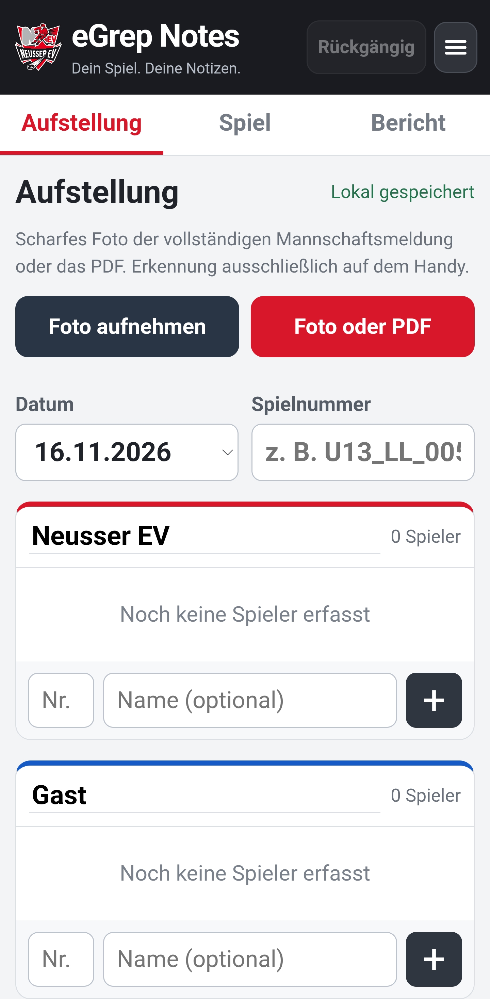

# eGrep Notes

**Dein Spiel. Deine Notizen.** Der Schnellnotiz-Zettel für den Punktrichter-Tisch: Offline-Spielnotizen fürs Eishockey, mit allem, was später ins offizielle eGrep (elektronischer Spielbericht) muss. Schnell, mit großen Knöpfen, funktioniert ohne Internet.

Private Notiz-App. Kein Bezug zum offiziellen eGrep, zum DEB oder zum EHV NRW.



## Funktionen

**Erfassen**
- Beim Bearbeiten zeigt die App, was bisher eingetragen war
- Tore (Schütze, bis zu zwei Assists), Strafen, Penaltys, Torwartwechsel, Timeouts und Notizen, jeweils mit der abgelesenen Uhrzeit
- Spieler per Antippen aus der Aufstellung wählen oder Nummer eintippen
- Drei Zeitmodi pro Spiel: Uhr läuft ab, Uhr läuft auf (Hallenuhr, jedes Drittel ab 0:00), Spielzeit 0:00 bis 60:00
- Strafmaß 2, 2+2, 5, 10 Min. und Spieldauer, „+10 Min.“ als zweiter Eintrag
- Bei Torwart- und Bankstrafen fragt die App, wer die Strafe absitzt (oder „später eintragen“)
- Wischen zwischen Aufstellung, Spiel und Bericht
- Strafen nach Häufigkeit in EHV-Spielen sortiert; Schiri-Zeichen einblendbar, über das Menü und per langem Druck aufs App-Symbol
- Torwart raus fürs leere Tor; Empty-Net-Tore werden automatisch markiert
- Hinweis auf mögliche Über- und Unterzahltore (nur Hinweis, keine Regelentscheidung)
- Penaltyschießen mit abwechselnden Teams

**Aufstellung**
- Per Foto oder PDF einlesen (Texterkennung mit Tesseract auf dem Gerät; PDFs mit Text werden direkt gelesen)
- Auch lange Listen mit 20+ Spielern je Mannschaft; unsichere Namen und Nummern werden gelb markiert
- Spieler-Gedächtnis und EHV-Abgleich: Vorschläge zu Schreibweise, Nummer und Torwart; fehlende Spieler aus dem EHV-Spielbericht ergänzen

**Einstellungen und Sicherung**
- Sicherung aller Spiele, des Spieler-Gedächtnisses und der Einstellungen als Datei; Update-Prüfung über die Projektseite
- Heimmannschaft aus den Mitgliedsvereinen des EHV NRW wählen (mit Wappen) oder eigenen Namen eintragen. Voreinstellung: Neusser EV.

**Auswertung**
- Spielbericht mit Drittelständen, Vereinslogos und Bedienername, als Text kopieren oder drucken / PDF
- Archiv der letzten 20 Spiele

## Installation

Aktuelle Version auf der Projektseite laden: **[cappy0815.github.io › eGrep Notes](https://cappy0815.github.io/#egrep-notes)** (APK mit SHA-256-Prüfsumme). Installation aus unbekannten Quellen erlauben. Updates installieren sich über die alte Version, die Spiele bleiben erhalten.

Alle Spieldaten bleiben auf dem Gerät. Internet braucht die App nur für die Update-Prüfung und den EHV-Abgleich (beides abschaltbar); dabei werden keine Spieldaten gesendet.

## Versionen

Siehe [CHANGELOG.md](CHANGELOG.md).

## Aufbau und Bauen

```
app/src/main/assets/   Oberfläche: index.html, styles.css, logic.js, app.js, ocr.js, Logos, OCR, pdf.js
app/src/main/res/      App-Symbol
app/src/main/java/     ältere Java-Referenz des Android-Hosts (nicht gepflegt, wird für die APK nicht benutzt)
native_builder.py      erzeugt den Android-Host (classes.dex) direkt als Bytecode
build_apk.py           Manifest, Ressourcen, OCR-Paket, Signatur (Python 3 + OpenSSL, kein Android SDK)
docs/ENTWICKLUNG.md    ausführliche Entwicklungsnotizen
tests/                 Node (Logik, OCR-Hilfen) und Playwright/Chromium (Oberfläche, Druck), APK-Prüfungen
```

```
python3 build_apk.py --signing-dir <Ordner mit egrep-notes-key.pem und egrep-notes-cert.pem> --output dist/eGrep-Notes.apk
```

Der private Signaturschlüssel ist nicht im Repo. Das öffentliche Zertifikat liegt als `PUBLIC-SIGNING-CERT.pem` bei (SHA-256 in `SIGNING-CERT-SHA256.txt`). Mit einem anderen Schlüssel gebaute APKs lassen sich nicht über die veröffentlichte Version installieren.

Tests, z. B.:

```
node tests/test_v29_logic.js
CHROMIUM=/pfad/zu/chromium python3 tests/test_v30_ui.py /tmp/egrep-tests
python3 tests/test_apk.py dist/eGrep-Notes.apk
```

Testdaten verwenden Fantasienamen.

## Quellen und Lizenzen

- Texterkennung: Tesseract.js und deutsches Sprachmodell (tessdata_fast), Apache 2.0
- PDF lesen: PDF.js 3.11.174 (Mozilla), Apache 2.0
- Vereinslogos: hockeydata (wie ehv-nrw.de) und Mitgliederliste von ehv-nrw.de. Die Logos sind Marken der jeweiligen Vereine.
- Details: [THIRD_PARTY_NOTICES.md](THIRD_PARTY_NOTICES.md), [SOURCES.md](SOURCES.md)

Michael Nowak & KI · [cappy0815.github.io](https://cappy0815.github.io/)
